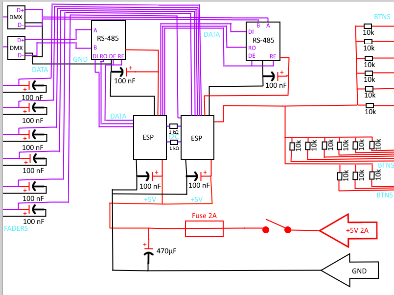

**DMX EASY**
DIY DMX lighting controller based on ESP32, featuring 6 faders, 53 buttons and a custom 3D-printed enclosure.
I made this project because I need an DMX Table but its so expensive

## Overview
Features:
- 6 channel faders
- 53 programmable buttons
- DMX512 output
- Dual ESP32 architecture
- 3D printable enclosure
- Low-cost and easily reproducible design

## Hardware
See the BOM in [bom.csv](BOM.csv) or at the end of file

## Recap:
**Case:**

**Assembly**
)

**Scheme:**

**Script**
[Here script files](dev/ESP/ESP_DMX/DMX_Controller/DMX_Controller.ino)

**Files**
[Case](assets\DMXEasy.step)
[Case Bottom](assets\BottomDMXEasy.step)
[Assembly](assets\AssemblageDMXEasy.step)
[Scheme](assets\scheme.pdn)

## BOM

| Item | Quantity | Unit Price ($) | Total Price ($) | Notes | URL |
| --- | ---: | ---: | ---: | --- | --- |
| Slide Fader | 6 | 1.74 | 10.44 | | [Link](https://fr.aliexpress.com/item/1005006152089336.html) |
| Push Button | 1 | 17.16 | 17.16 | Pack of 53 buttons | [Link](https://fr.aliexpress.com/item/1005003911184656.html) |
| ESP-WROOM-32 | 2 | 5.80 | 11.60 | 1 for logic/DMX, 1 for input management | [Link](https://fr.aliexpress.com/item/1005005655238798.html) |
| MAX485 RS-485 Module | 1 | 2.83 | 2.83 | Pack of 2 modules | [Link](https://fr.aliexpress.com/item/1005005737922222.html) |
| 5V 4A Power Supply | 1 | 11.12 | 11.12 | | [Link](https://fr.aliexpress.com/item/1005008468643815.html) |
| 470uF 16V Electrolytic Capacitor | 1 | 4.63 | 4.63 | | [Link](https://fr.aliexpress.com/item/1005009417460390.html) |
| 100nF 50V Ceramic Capacitors | 1 | 7.06 | 7.06 | Pack of 20 | [Link](https://fr.aliexpress.com/item/1005012122696428.html) |
| ON/OFF Power Switch | 1 | 1.31 | 1.31 | | [Link](https://fr.aliexpress.com/item/1005010015277754.html) |
| 1k Ohm Resistor | 1 | 5.09 | 5.09 | | [Link](https://fr.aliexpress.com/item/1005011813359681.html) |
| 10k Ohm Resistor | 1 | 6.02 | 6.02 | | [Link](https://fr.aliexpress.com/item/1005011813359681.html) |
| 120 Ohm Resistor | 1 | 6.02 | 6.02 | | [Link](https://fr.aliexpress.com/item/1005011813359681.html) |
| Diodes | 1 | 1.09 | 1.09 | Pack of 100 | [Link](https://fr.aliexpress.com/item/1005002339916163.html) |
| 3-Pin XLR Connectors | 1 | 4.86 | 4.86 | Pack of 4 | |
| DC Power Jack | 1 | 1.43 | 1.43 | | [Link](https://fr.aliexpress.com/item/1005011863804603.html) |
| Panel Mount Fuse Holder | 1 | 2.08 | 2.08 | Pack of 10 | |
| 250V 2A Glass Fuse | 1 | 2.27 | 2.27 | | |
| Prototype PCB Board | 1 | 3.70 | 3.70 | | |
| Electrical Wire | 1 | 3.24 | 3.24 | | [Link](https://fr.aliexpress.com/item/1005006996255957.html) |
| Solder Wire | 1 | 5.32 | 5.32 | | [Link](https://fr.aliexpress.com/item/1005009973086759.html) |
| Heat Shrink Tubing | 1 | 2.54 | 2.54 | 164-piece kit | |
| PLA Filament 1kg | 1 | 18.55 | 18.55 | | [Link](https://fr.aliexpress.com/item/1005007175412873.html) |
| **TOTAL** | | | **134.36** | | |

## How it's works ?
DMXEasy is a low-cost DIY DMX controller based on two ESP32 microcontrollers.
The user interacts with the controller using the 53 buttons and 6 faders. The buttons are arranged in a matrix to reduce the number of GPIO pins required. The faders provide analog values that can be read by the ESP32.
One ESP32 is dedicated to handling the physical inputs, while the second ESP32 handles the controller logic and generates the DMX512 data.
The general data flow is:
Buttons / Faders
       ↓
Input ESP32
       ↓
Control data
       ↓
Main ESP32
       ↓
DMX512 data
       ↓
MAX485
       ↓
XLR DMX output
       ↓
DMX lighting fixtures

When a button is pressed or a fader is moved, the input ESP32 detects the change and sends the corresponding control information to the main ESP32. The main ESP32 processes this information and updates the DMX values.
The updated DMX data is then transmitted using the DMX512 protocol. Since DMX512 uses an RS-485 physical layer, a MAX485 module is used to convert the ESP32's serial signal into the differential signal required by DMX.
The final result is that changing a control on the physical console changes the corresponding DMX values sent to the lighting fixtures.
The project is designed so that the hardware remains relatively simple and inexpensive while providing a physical interface for controlling DMX equipment.

## Conclusion

This project was really interesting for me because I learned a lot of things about electronics, ESP32 and DMX protocol.

It was not always easy, I had some problems with the wiring, the code and the assembly, but finally I managed to make it work.

I'm happy with the final result because I now have my own DMX controller for a much lower price than a commercial one.

Of course, it's not perfect and I can improve some things in the future, but for a DIY project I think it's pretty good!

Thanks for reading my project!
